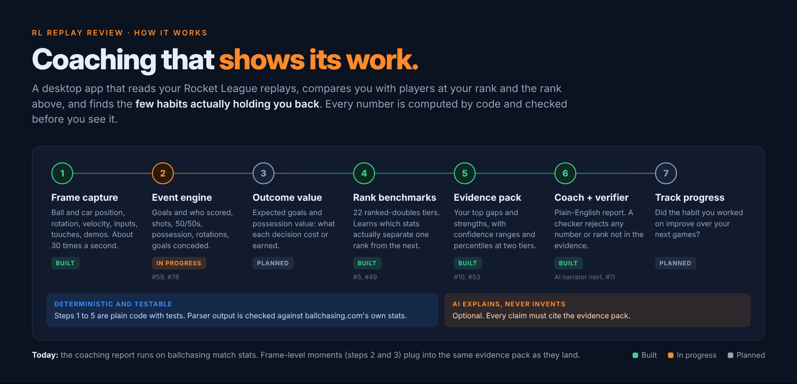
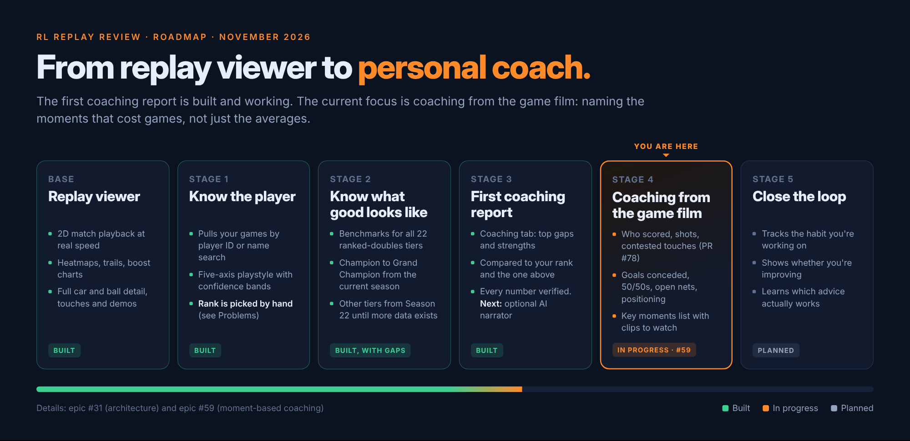
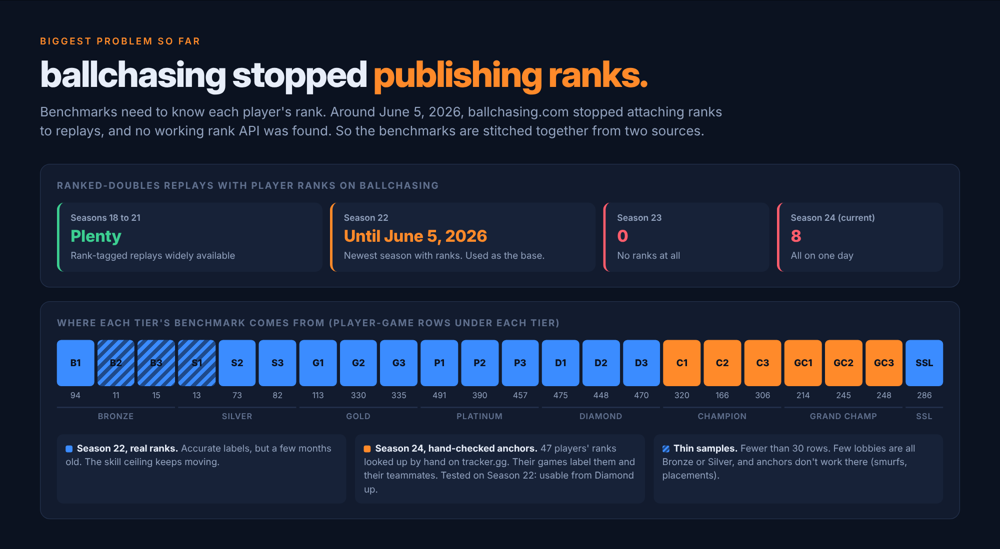

# RL Replay Review

A desktop coaching app for Rocket League. It reads your replays, compares you with players at your rank and the rank above, and tells you which few habits are actually holding you back. Every number it shows is computed by code and checked before you see it.

Built with Tauri (Rust) + React + TypeScript, on data from [ballchasing.com](https://ballchasing.com).



## What it does

### Replay Review
- **Frame-level playback.** Downloads and parses the `.replay` file and plays the match back on a 2D field at real speed, with smooth interpolation between frames.
- **Full car and ball detail.** Position, rotation, velocity and controller inputs for every car, plus touches, demos and kickoffs.
- **Heatmaps and trails** for players, teams and the ball.
- **Stats and comparison.** Per-player core, boost, movement, positioning and demo stats from the ballchasing API, side by side.
- **Charts.** Boost over time, speed categories, and goal markers on the timeline.

### Coaching
- **Your games, pulled in for you.** Find your recent ranked 2v2 games by player link or ID, or by a ballchasing name search. You confirm which accounts are yours.
- **Compared with your rank and the next one up.** Uses bundled benchmarks for all 22 ranked-doubles tiers.
- **Only what the data supports.** Each stat gets an estimate with an 80% range. A gap is only called a weakness when the whole range sits below the tier's middle 50%. Stats that don't separate ranks never make the top three. Fewer than 10 games gives "not enough data", not a guess.
- **Plain-English report.** Top gaps with practice advice, top strengths, and every other finding grouped by category. A verifier checks every number and rank name in the text against the evidence pack.
- **Playstyle.** Five descriptive axes (Aggression, Mechanical, Boost Discipline, Team Play, Aerial Tendency) relative to your rank, with confidence bands and an archetype once there are enough games. Playstyle describes how you play. It is never scored as a weakness.

## Status and roadmap



| Stage | What it delivers | Status |
|---|---|---|
| Replay viewer | Playback, heatmaps, stats, full frame capture | Built |
| 1. Know the player | Game search by ID or name, five-axis playstyle | Built |
| 2. Know what good looks like | Benchmarks for 22 tiers ([#5](../../issues/5)) | Built, with gaps (see below) |
| 3. First coaching report | Coaching tab, evidence pack, verified text | Built. Optional AI narrator next ([#11](../../issues/11)) |
| 4. Coaching from the game film | Goals conceded, 50/50s, open nets, positioning, key moments with clips ([#59](../../issues/59)) | In progress ([#78](../../pull/78)) |
| 5. Close the loop | Track whether the targeted habit improves | Planned |

The design behind these stages is in [#31](../../issues/31) (evidence-based coaching architecture) and [#59](../../issues/59) (coaching that explains moments, not just averages).

## Problems we've run into

### ballchasing stopped publishing ranks



Benchmarks need to know each player's rank, and ballchasing.com used to attach it to every player in a replay. Around **June 5, 2026** that stopped: Season 23 has no ranked-doubles replays with ranks, and the current season has 8. Duels and standard dropped off too.

We looked for another source and didn't find one that works:
- **tracker.gg:** API key rejected, and the Rocket League endpoint is behind Cloudflare. Automating the website would break its terms.
- **`api.rocketleague.com`:** the domain no longer resolves.
- **RapidAPI `rocket-league1`:** has a ranks endpoint, but its listing reports a 0% success rate. Untested.

What we did ([#5](../../issues/5), [#44](../../pull/44) to [#52](../../pull/52)):
- **Season 22 as the base.** It's the newest season with real per-player ranks.
- **Manual anchors for the current season.** We look up a set of players' ranks by hand on tracker.gg and label their games (and their teammates) with that rank. We tested the method on Season 22, where true ranks are known: it's usable from Diamond up (Champion 3 and above: 90 to 97% within one tier), and unreliable in Bronze and Silver, where lobbies are full of smurfs and placement players.
- **Mixed benchmarks with provenance.** Champion 1 to Grand Champion 3 come from 47 hand-checked anchors in the current season. Everything else is Season 22. Every tier records its season and rank source, and the coaching report shows which seasons it used.
- **You pick your rank.** The app can't detect it any more.

Still open: Diamond and SSL need more anchors before they switch to current-season data. Bronze to Gold have no current-season source at all.

### Everything else

**Data and coaching**

| Problem | What we did | Ref |
|---|---|---|
| Very few lobbies are all Bronze or all Silver, so Bronze 2, Bronze 3 and Silver 1 have under 30 rows each. | Marked `low_sample`. The app falls back to the nearest tier when one is missing, and says so. | [#44](../../pull/44) |
| Seasons don't record the same stats. The current season has 9 that Season 22 doesn't (aerial hits, flip resets, clears and more). | A tier may lack stats other tiers have, and coaching handles a missing stat per tier. | [#48](../../pull/48) |
| On real players, rare stats (bicycle hits, demos in the defensive half) produced priorities around 10¹³, and weak signals contradicted each other ("most forward" a weakness, "most back" a strength). | Spread fallbacks, rare-event stats skipped, and a minimum rank signal of 0.15 for the top three. | [#53](../../pull/53) |
| Shots against and goals against rise with rank because games get faster, so the engine called *fewer* shots against a weakness. | Excluded from findings. | [#55](../../pull/55) |
| A player-ID search misses games on a player's other platform accounts, and a name search can match strangers. | Name search lists every account seen under that name with game counts, and you tick which are yours. | [#58](../../pull/58) |

**Replay parsing**

| Problem | What we did | Ref |
|---|---|---|
| Replays recycle actor IDs: a destroyed car's ID is often reused for a *different* player's next car. Players were drawn at teammates' positions and dropped from frames (one full-match player was present in only 74% of frames). | Car-to-player links are tracked live, frame by frame. Presence went to 98.8%, and the gaps are demos. | [#37](../../pull/37) |
| Each car's position updates every 1 to 3 network frames on its own schedule, so sampled positions were up to ~70 ms stale and motion pulsed. | Positions are projected forward by velocity to the sample time. | [#37](../../pull/37) |
| Current replays only send `DemolishExtended`, so no demos were detected. A respawned car can be re-created under the same ID and repeat the old demo, and the victim's player link is unset in the demo frame. | All three handled. On a Season 17 test replay, demos match ballchasing's count, attacker and victim. | [#33](../../pull/33) |
| The first touch detector credited 2 of 7 goals on a Season 17 test replay to the wrong player. | Touches resolve the player at that moment. 7 of 7 now match. Goal attribution from the replay header is in review. | [#33](../../pull/33), [#78](../../pull/78) |
| Replays have no frames during goal replays, so frame times jump 2 to 9 seconds after each goal. | Playback never interpolates across a gap and skips over it. | [#39](../../pull/39) |
| Players who disconnect mid-game are missing from frame data. | Open. | [#24](../../issues/24) |
| Boost pad pickups are detected by proximity, not from the replay's pad state. | Open. | [#25](../../issues/25) |

**App and API**

| Problem | What we did | Ref |
|---|---|---|
| Every playback speed ran at the same 7 to 14 times real time. | Continuous playback clock, interpolation between frames. | [#39](../../pull/39) |
| The rate limiter treated ballchasing's 70-per-week *upload* quota as a read budget, so the app stopped working after a few loads. It also assumed every key was free tier. | Reads the key's tier from the API and uses ballchasing's real per-second and per-hour limits for each endpoint group. | [#41](../../pull/41) |
| All API requests failed on networks with TLS-inspecting proxies (corporate Netskope, Zscaler). | Trusts the operating system's certificate store as well as the bundled one. | [#35](../../pull/35) |
| Pasting anything other than a `/replay/` page link sent the whole text to the API as the replay ID. | Finds a replay ID anywhere in the pasted text, or says it couldn't. | [#43](../../pull/43) |
| The benchmark collector's SQLite writes triggered a full app reload in dev about every 11 seconds. | Vite ignores `tools/`. | [#44](../../pull/44) |

**Coming up:** moment-based coaching needs the `.replay` file for every game in a coaching sample, which means many downloads against ballchasing's file limits. Sample size, download strategy and caching are being worked out in [#61](../../issues/61). Detection accuracy will be measured against a hand-labeled set of moments ([#62](../../issues/62)).

## Getting started

### Prerequisites
- [Rust](https://www.rust-lang.org/tools/install), latest stable (2024 edition)
- [Node.js](https://nodejs.org/) 22 or newer
- The [Tauri v2 system dependencies](https://v2.tauri.app/start/prerequisites/) for your OS
- A [ballchasing.com](https://ballchasing.com) API key. The free tier works.
- Python 3.12 or newer, only if you want to rebuild benchmarks (`tools/`, standard library only)

### Install and run
```bash
npm install
npm run tauri dev      # run in development mode
npm run tauri build    # build for production
```

On first launch the app asks for your ballchasing.com API key. You can get one at [ballchasing.com/upload](https://ballchasing.com/upload) after logging in. The app detects your key's tier and paces requests to match.

### Usage

**Replay Review**
1. Paste a ballchasing.com replay link or ID.
2. View stats, analysis and player comparison.
3. Click **Load Frame Data** for playback, heatmaps and trails.

**Coaching**
1. Open the **Coaching** tab.
2. Enter your player link or ID, or type a player name and click **Find games**, then tick which accounts are yours. You can also pick a player from the replay you have loaded.
3. Pick your rank and how many recent games to analyze (10 to 200), then **Save**.
4. Click **Generate report**.

### Checks before a PR
```bash
cd src-tauri && cargo test && cargo clippy --all-targets -- -D warnings && cd ..
npx tsc --noEmit
npx vitest run
npm run build
```

## Architecture

```
src/                        React frontend
  components/
    field/                  Field rendering, heatmaps, trails
    stats/                  Stat panels, player comparison
    charts/                 Boost and movement charts
    timeline/               Playback controls, scrubber, goal replays
    input/                  API key setup, replay input, settings
    coaching/               Coaching tab: profile form, report, findings, playstyle
  hooks/                    Zustand stores (useReplay, usePlayback, useCoaching)
  types/, lib/              Types, Tauri command wrappers, field math

src-tauri/src/              Rust backend
  parser/                   .replay parsing via boxcars, live actor state, events
  api/                      ballchasing.com client, per-tier rate limiter
  benchmark/                Load benchmarks.json, nearest-tier fallback
  profile/                  Player aggregate across games, playstyle
  coaching/                 Evidence pack engine, report text, verifier
  analysis/                 Per-replay boost and rotation insights
src-tauri/resources/
  benchmarks.json           Per-rank stat distributions (generated, never hand-edited)

tools/benchmark-generator/  Python collector, anchor workflow, benchmarks.json builder
docs/images/                README graphics (source in docs/images/src/)
```

Design decisions, conventions and the agent workflow are in [CLAUDE.md](CLAUDE.md). The benchmark pipeline is documented in [tools/benchmark-generator/README.md](tools/benchmark-generator/README.md).

## ballchasing API usage

The app reads your key's tier from `GET /api/` and follows ballchasing's [published limits](https://ballchasing.com/doc/api) for each endpoint group. It also honors `429` and `Retry-After`. Settings shows hourly usage for each group.

| Tier | List replays | Get a replay | Download a replay file |
|---|---|---|---|
| regular | 2/s, 500/h | 2/s, 1,000/h | 1/s, 200/h |
| gold | 2/s, 1,000/h | 2/s, 2,000/h | 2/s, 400/h |
| diamond | 4/s, 2,000/h | 4/s, 5,000/h | 2/s, 1,000/h |
| champion | 8/s | 8/s | 2/s, 2,000/h |
| gc | 16/s | 16/s | 2/s |

A coaching report fetches one replay's stats per game analyzed, plus a few search calls. Loading frame data downloads one replay file.

## Contributing

The backlog is in [issues](../../issues), labeled by area and priority. Each issue has implementation notes and acceptance criteria so it can be picked up cold. Read [CLAUDE.md](CLAUDE.md) first.

## License

Not chosen yet.
